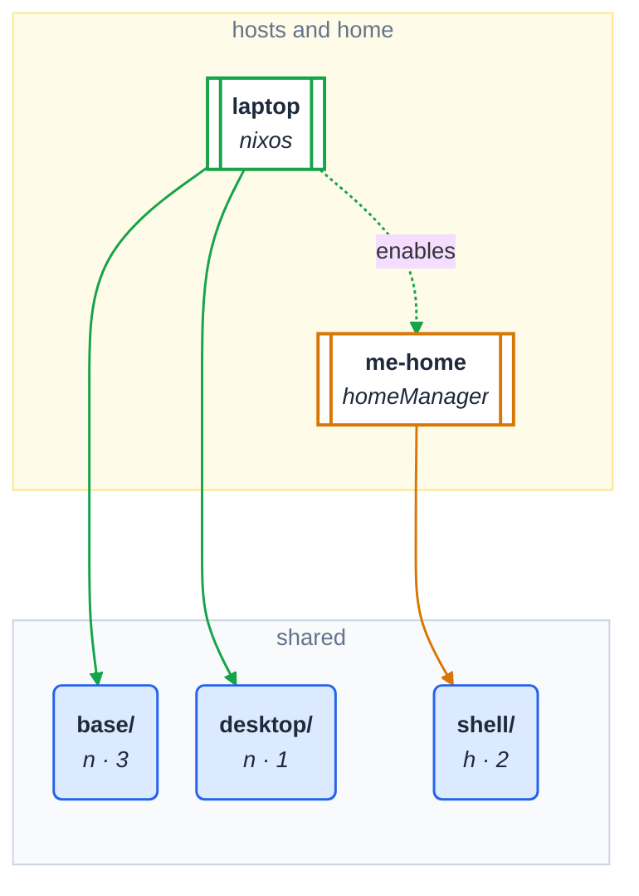

# flake-module-graph

> **Experimental. Don't use this unless you know what you're doing.** It is
> young, and everything here may change without notice: the commands and
> flags, the layout file, what the drawings and the page show, and the
> document format it reads (dirs-as-categories' `flake.moduleGraph`, itself
> experimental). If you use it anyway, pin a revision and check its output
> after updating.

Draws a flake's modules tree: which categories exist, what sits in them, and
which host includes what. Mermaid and Graphviz diagrams, and an interactive
page where clicking hosts shows only what they reach.

The hosts view of a small flake -- a laptop including the categories
`base` and `desktop`, and the Home Manager configuration `me-home`
including `shell`, which a module in `base` turns on (`enables`):

<!-- module-graph: hosts -->

<!-- /module-graph -->

(The document is `tests/fixtures/example.json`, the example
[wiki/using-the-tool.md](wiki/using-the-tool.md) uses; the unit tests fail
when this drawing is stale.)

It reads a **module-graph document** (JSON, format version 1) and never
parses `.nix` files. [dirs-as-categories](https://github.com/NireBryce/dirs-as-categories)
publishes one as `flake.moduleGraph`; any tool can write one
([the format](https://github.com/NireBryce/dirs-as-categories/blob/main/doc/format.md)).
[wiki/using-the-tool.md](wiki/using-the-tool.md) walks through every view,
reading the drawings, the interactive page and each error.

## Use

These need [Nix](https://nixos.org/download) with flakes turned on. On a fresh
install, put `--extra-experimental-features 'nix-command flakes'` after `nix`
in the first command, or turn them on for good in `~/.config/nix/nix.conf`:
`experimental-features = nix-command flakes`.

```sh
nix run github:NireBryce/flake-module-graph -- hosts --flake .            # Mermaid, hosts view
nix run github:NireBryce/flake-module-graph -- html -o modules.html          # the flake here, as a page
nix eval --json .#moduleGraph | nix run github:NireBryce/flake-module-graph -- dot - --view hosts
```

| Command | Draws |
|---|---|
| `tree` | categories, folders and modules, left to right (Mermaid) |
| `hosts` | hosts and what they include, top-down (Mermaid) |
| `dot` | either, as Graphviz (`--view tree\|hosts`) |
| `html` | the hosts view as a self-contained interactive page |
| `markdown` | redraws the drawings kept in a Markdown file (`--file`), or checks them (`--check`) |

The document is a file, `-` for stdin, or `--flake REF` (runs
`nix eval --json REF`, with flakes turned on for that command; a REF without
`#` means `REF#moduleGraph`). With none of them, a `flake.nix` in the current
directory is read as `--flake .`. `-o FILE` writes the drawing to FILE, and
only once it has succeeded.

Filters: `--category NAME` (that category and what is nested in it),
`--depth N`, `--categories-only`, `--wrap N` (categories per row in the
hosts view; 0 for one row).

### As a flake input

To keep the command in your own flake (a dev shell, a NixOS or home-manager
configuration), add it as an input that **follows your nixpkgs**, so it is
built from the nixpkgs you already have instead of fetching a second one:

```nix
{
  inputs = {
    nixpkgs.url = "github:NixOS/nixpkgs/nixos-unstable";
    flake-module-graph = {
      url = "github:NireBryce/flake-module-graph";
      inputs.nixpkgs.follows = "nixpkgs";
    };
  };

  outputs = { nixpkgs, flake-module-graph, ... }: {
    devShells.x86_64-linux.default = nixpkgs.legacyPackages.x86_64-linux.mkShell {
      packages = [ flake-module-graph.packages.x86_64-linux.default ];   # `module-graph`
    };
  };
}
```

Without the `follows` line it still works, with this repository's pinned
nixpkgs. In a NixOS or home-manager module, the package is
`flake-module-graph.packages.${pkgs.stdenv.hostPlatform.system}.default`.

## What it shows

- **Categories** -- folders a host can include by name -- are blue rounded
  cards. One that holds a nested category is drawn as a pale blue box around
  it.
- **Plain folders** inside a category are slate and square: collected only
  through the category.
- **Modules** are white, even when a host names one: importable means a
  category.
- **Hosts** (a module with `includes`, outside every category) get one hue
  each, shared by their edges. A host's link to a home configuration it turns
  on (`enables`) is dashed.
- A category nothing reaches is outlined red; one reached only through a
  module named on its own is dashed. A name a host includes that doesn't
  exist is a red card.

## Where areas go

Top-level folders are areas. With no settings, every area is laid out the
same way, alphabetically. A TOML file says which areas belong where:

```toml
# module-graph.toml
[layout]
top    = ["hosts", "users"]        # Mermaid/Graphviz hosts view: above the hosts
behind = ["hosts"]                 # page: before the hosts
beside = ["services"]              # page: next to the hosts
far    = ["users"]                 # page: the far end, past the shared areas
shared = ["shared", "packages"]    # page: these first, in this order
```

```sh
nix run github:NireBryce/flake-module-graph -- html --flake . --config module-graph.toml > modules.html
```

The page's flow, top-down or left to right (toggle on the page; kept in the
URL with the selection):

```
behind  ->  hosts  ->  shared areas  <-  homes  ->  far
            beside
```

## Development

```sh
nix flake check                 # unit tests, the packaged command
python3 -m unittest discover -s tests
python3 tests/golden.py         # every view against tests/expected/golden/ (--update)
python3 tests/browser.py        # the page in headless Chromium (chromium on PATH)
```

## Licence

Apache-2.0. Copyright Nire Bryce.
