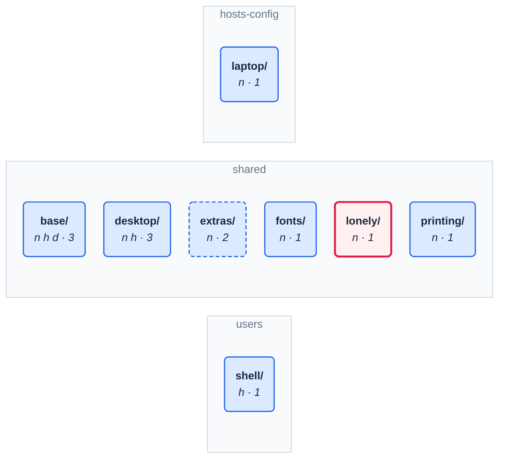
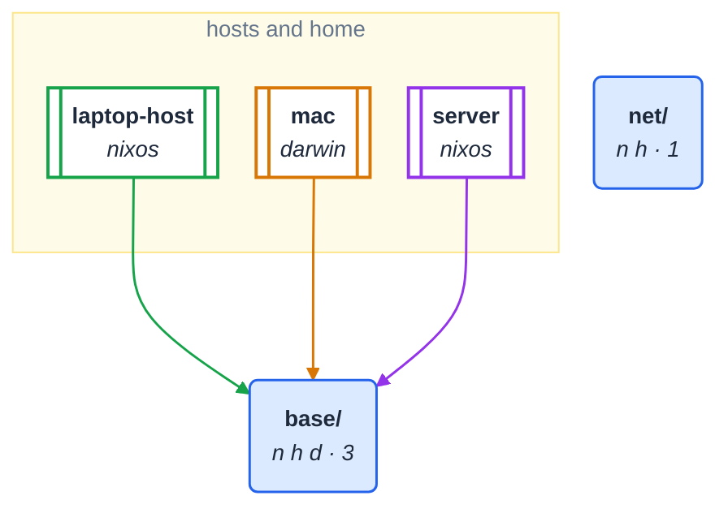

# Drawings kept current

`checks.markdown` in flake.nix runs `lib.checkMarkdown` on this file: a
drawing here that no longer matches tests/fixtures/golden.json fails it.
Redraw with `python3 -m module_graph markdown tests/fixtures/golden.json
--config tests/fixtures/golden.toml --file tests/fixtures/drawings.md`.

<!-- module-graph: tree --depth 1 --categories-only -->

<!-- /module-graph -->

<!-- module-graph: hosts --category base -->

<!-- /module-graph -->
